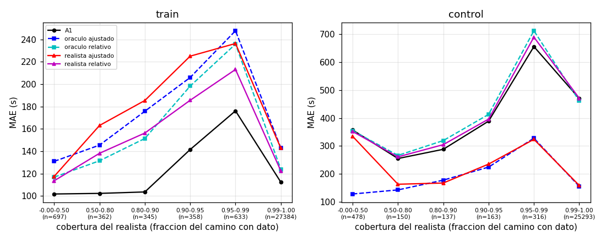
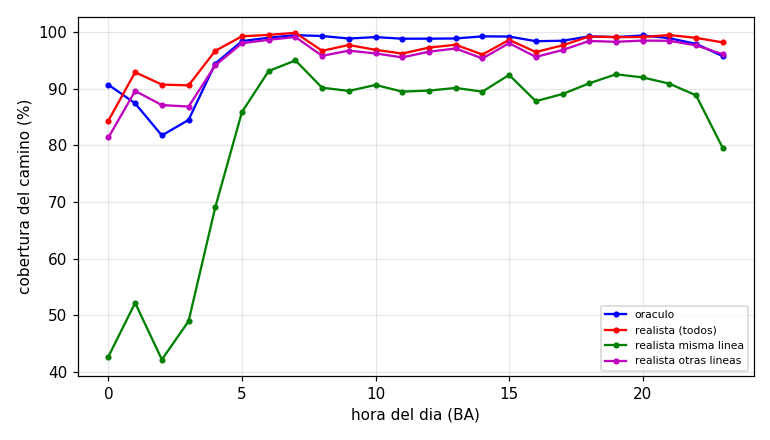

# Techo del tránsito (ARQUITECTURA.md §6.2.1)

Fecha: 2026-11-12. Scripts: `prediccion/v2/diag/ceiling/` (`run_ceiling.py`, `build_typical.py`, `label_noise.py`, `report.py`, `common.py`). Filas por día en `data/ml/v2/diag/ceiling_days/`.
Alcance: subconjunto chico de §6.2.2 sobre la vara de siempre. Train: 26, 39, 42, 92, 124, 151, 168, 50, 106, 107, 108, 132 (`eval_seen`, 29.779 filas). Control: 12, 15, 128 (`eval_heldout`, 26.537 filas). Todas las filas de esas líneas, 25 días de validación. No se entrenó nada ni se tocó el modelo, el pipeline ni los datos.

## Resumen y conclusión

**Qué se hizo.** Por cada fila (P a tiempo t, objetivo T) se recorre el camino P->T sobre el shape ex post del eval (misma fuga para todos los métodos) en pasos de ~100 m, cada paso a su celda de la grilla, y se simula un coche virtual: A1 paso a paso; **oráculo** (velocidad observada en la celda en la ventana de 2 min del tiempo simulado, luego +1 y -1, si no A1); **realista** (5 ventanas completas previas a t, 10-12 min, sin futuro, si no A1). La exclusión del coche propio es **exacta**: se recalculó la tabla del NDJSON de cada día de validación (coincide al 100 % con la tabla diaria) y se restó el coche de la fila (identificado por línea, shape y hora de salida del viaje; 97,4 % de las filas casan).

**Hallazgos.**
1. **A1 se reproduce**: sobre todo `eval_seen` da 42,2 / 88,5 / 133,5 / 212,7 s por bucket, igual que la vara. El simulador paso a paso difiere de A1 en 11 s por fila (media; MAE 116,7 vs 113,6 en train) por la discretización (bloques de 500 m desde P vs pasos de 100 m).
2. **La cobertura no es el límite: es 97-99 % del camino** (oráculo 98,0 % en train y 99,1 % en control; realista 97-98 %; de madrugada 93-95 %), por línea (95,5-99,6 %), hora y distancia. Los tramos "de una sola línea" prácticamente no existen en estas líneas: solo 2,7 % de los pasos (0,7 % mirando las 129 líneas), y la tabla agrega toda la flota, no solo la línea. El n por celda-ventana es mayoritariamente alto en tramos compartidos (mediana en 6-10, 37 % con 11+ en el oráculo) y bajo en los de una línea (46 % con n = 1). Coches de la misma línea (el de adelante o atrás): 88 % de cobertura realista; coches de otras líneas: 96-98 %.
3. **Con cobertura casi total, el tránsito no le gana a A1 en líneas conocidas, ni siquiera el oráculo con futuro.** MAE global en train: A1 113,6 s; oráculo 126-148 s según la variante (crudo 147,9; ajustado 146,1; relativo a lo típico 127,5; relativo + mezcla 116,8); realista 121-153 s (relativo 125,5). Las variantes que pesan la observación con A1 convergen a A1. La mejor mezcla lineal A1 + tránsito (pesos ajustados en días pares y probados en impares) gana **2,5 s (2,2 %) con el oráculo y 1,3 s (1,2 %) con el realista**; con la variante relativa, 0,4 s y 0 s. Solo en ~44 % de las filas la variante relativa del oráculo está más cerca que A1 (moneda al aire). Tampoco hay ganancia al mirar solo celdas de una línea o solo compartidas, ni solo coches de la misma línea o de otras (sección 8, con salvedad de sesgo ahí). Sin diferencias grandes por bucket de ETA ni por distancia (secciones 3 y 5).
4. **Por qué.** (a) A1 ya trae la velocidad típica por tramo, hora y día; el tránsito solo agrega la *desviación* respecto de lo típico y en celdas de 500 m x 2 min con pocos coches esa desviación es ruidosa. (b) La velocidad de la tabla es la media de los intervalos en movimiento (>= 1 m/s): no contiene paradas ni demoras, así que usada cruda subestima el tiempo (sesgo -71 s en train; ver sección 9). La versión ajustada por detenidos corrige el sesgo (+19 s) pero el MAE sigue peor que A1.
5. **Excepción: líneas sin tabla A1.** En control A1 no tiene tabla (cae a 7 m/s: sesgo -443 s, MAE 467 s). Ahí la velocidad observada en las celdas sí ayuda muchísimo: oráculo ajustado 158 s, realista ajustado 165 s (-65 %), y el realista casi iguala al oráculo. Es un resultado sobre qué tan malo es el naive de 7 m/s, no sobre "el tránsito mejora una tabla": en train, con tabla, A1 ya está en 114 s. Pero sugiere que una **velocidad típica por celda, independiente de la línea** (como la `ceiling_typical.npz` de este análisis) sería un A1 que generaliza a líneas no vistas; no se probó contra una tabla por celda con etiquetas.
6. **Efecto de la aproximación `n >= 2`** (vs exclusión exacta, oráculo crudo): MAE train 143,3 vs 147,9 s, diferencia absoluta media por fila 22,8 s, cobertura 95,6 vs 98,0 %. La aproximación es optimista (descarta celdas con un solo coche aunque sean de otra línea y deja el propio coche cuando hay n >= 2): hay que usar la exclusión exacta.

**Ruido de etiqueta.** Leave-one-out sobre 5,3 M tripletas de pings (hueco de 120 s, punto interpolado por distancia): MAE 18,6 s, P50 15,9, P90 39,3 (cota superior para un hueco de 60 s); estimado para el hueco real de 60 s: MAE ~6 s (rango 6-19 s según el supuesto de escalado). El antecedente histórico es P50 ~24 s, P90 ~52 s (incluye además errores de parada). En todo caso es chico frente al MAE de A1 (114 s en train; 41 s en 0-5 min, donde el ruido de etiqueta ya pesa más).

**Qué parte del error de A1 no explica el tránsito.** Prácticamente todo, con esta señal y este uso: el techo medido es ~2 % (~2,5 s de 114). El error de A1 está en el ruido de etiqueta (entre 6 y 19 s; en 0-5 min el MAE de A1 es ~41 s), en las paradas y demoras (en la salida de cabecera A1 tiene 143 s de MAE vs 105 s en el resto; con P detenido 120 s vs 109 s en movimiento) y en la variabilidad coche a coche, que el tránsito de la celda no captura. Esto coincide con la decisión de §6.2: **si oráculo ≈ A1, el tránsito no es prioridad** para líneas con tabla. El oráculo no es peor ni mejor por falta de cobertura sino porque la señal agregada por celda no agrega información sobre lo que ya sabe A1.

**Límites del análisis.** (i) Es una sustitución directa de velocidades en un sumador por tramos, no un modelo aprendido; un modelo que use el tránsito junto con el estado del coche podría aprovechar más, pero la mezcla óptima de un parámetro ya dice que la información lineal es poca. (ii) La tabla es de 500 m y 2 min y con velocidad solo en movimiento; una tabla más fina o con tiempo de recorrido (no velocidad) podría dar más. (iii) El oráculo asigna la ventana por el tiempo simulado con el propio simulador de velocidad, no con el recorrido real del coche; es un techo para esta construcción, no para toda la información posible. (iv) Los coches "misma línea" se identifican por los viajes del día (60 líneas); un coche sin viajes ahí cuenta como otra línea. (v) El desglose misma línea vs otras usa la velocidad típica de toda la flota como referencia, sesgada para subpoblaciones: la comparación entre ambas es poco confiable; lo sólido es que ninguna supera a A1 en train.

**Decisión sugerida.** No priorizar la capa de tránsito (E3a/E3b) para mejorar el error en líneas conocidas: el techo medido es ~2 %. Sí vale tenerla en cuenta como fuente de velocidad típica por celda para líneas no vistas (control), donde el problema es la falta de tabla, no el tránsito instantáneo.

---

## 1. Verificacion de A1

Reproduccion sobre todo `eval_seen` (100k filas), MAE por bucket de ETA 42.2 / 88.5 / 133.5 / 212.7 vs vara guardada 42.2 / 88.5 / 133.5 / 212.7; global 119.2 vs 119.2.

- train: A1 vara MAE 113.6 s, sesgo -27.0; A1 simulado paso a paso (100 m) MAE 116.7 s, sesgo -28.1; |vara - simulado| media 11.2 s, P50 5.7, P90 28.6, P99 73.7.
- control: A1 vara MAE 467.4 s, sesgo -442.7; A1 simulado paso a paso (100 m) MAE 467.4 s, sesgo -442.7; |vara - simulado| media 0.0 s, P50 0.0, P90 0.0, P99 0.0.

La diferencia viene de la discretizacion: A1 recorre bloques de 500 m desde la posicion de P (no alineados a la grilla de segmentos); el simulador usa pasos de ~100 m y toma el segmento de A1 del punto medio de cada paso.

**Control:** A1 no tiene tabla para las lineas de control (nunca entraron al train), asi que cae al fallback de 7 m/s en todo (ARQUITECTURA.md §7). En control, 'A1' es un naive de 7 m/s, no una tabla: la comparacion con el transito ahi mide otra cosa (el transito reemplaza a un naive, no a una tabla).

**Fuga comun:** todos los metodos usan el shape ex post que ya trae el eval (elegido con el viaje completo). Es la misma para todos.

## 2. Ruido de etiqueta

Leave-one-out sobre 5,265,437 tripletas de pings consecutivos (hueco total ~120 s, punto del medio interpolado por distancia como la etiqueta): MAE 18.6 s, P50 15.9, P90 39.3, sesgo 0.0 (cota superior para un hueco de 60 s). Estimacion para el hueco real de 60 s con T uniforme dentro del hueco (x1/3, ver docstring de `label_noise.py`): MAE ~6.2 s, P50 ~5.3, P90 ~13.1. Antecedente del plan historico: P50 ~24 s, P90 ~52 s. Es una estimacion, no una medicion directa de la etiqueta.

## 3. Error por metodo

MAE en segundos por bucket de ETA real (0-5, 5-10, 10-20, 20+ min), global y % de subestimaciones > 60 s (pred - real < -60). Sesgo = pred - real (+ sobreestima).

**train** (n=29779)

| metodo | MAE 0-5 | 5-10 | 10-20 | 20+ | MAE global | P50 | P90 | sesgo | subest.>60s % | subest. 0-5 % | subest. 5-10 % |
|---|---:|---:|---:|---:|---:|---:|---:|---:|---:|---:|---:|
| A1 (vara) | 40.6 | 81.2 | 123.4 | 192.1 | 113.6 | 70.1 | 260.6 | -27.0 | 32.9 | 12.1 | 33.4 |
| A1 simulado | 42.1 | 84.1 | 126.9 | 196.4 | 116.7 | 73.0 | 267.1 | -28.1 | 33.8 | 12.8 | 34.2 |
| Oraculo crudo | 44.9 | 96.3 | 151.8 | 273.0 | 147.9 | 89.2 | 351.1 | -71.1 | 43.2 | 16.0 | 43.4 |
| Oraculo ajustado por detenidos | 49.7 | 99.8 | 159.7 | 252.4 | 146.1 | 92.1 | 345.3 | 19.5 | 28.5 | 12.3 | 32.0 |
| Oraculo mezcla con A1 | 41.6 | 88.5 | 137.6 | 245.9 | 134.2 | 79.3 | 319.1 | -77.9 | 43.4 | 15.3 | 42.2 |
| Oraculo relativo (A1 x obs/tipica) | 46.3 | 90.2 | 139.4 | 215.1 | 127.5 | 80.7 | 293.5 | 7.0 | 28.5 | 12.2 | 31.4 |
| Oraculo relativo + mezcla | 42.8 | 84.4 | 128.0 | 195.0 | 116.8 | 74.0 | 267.3 | -17.7 | 31.6 | 12.2 | 33.1 |
| Realista crudo | 43.4 | 96.2 | 152.3 | 291.0 | 152.7 | 89.8 | 362.9 | -91.4 | 46.4 | 16.5 | 46.0 |
| Realista ajustado por detenidos | 47.7 | 98.4 | 157.6 | 256.4 | 145.9 | 90.4 | 340.9 | -1.6 | 31.8 | 12.6 | 33.8 |
| Realista mezcla con A1 | 42.3 | 92.9 | 146.3 | 279.4 | 146.9 | 85.5 | 348.5 | -91.8 | 46.1 | 16.2 | 45.0 |
| Realista relativo | 44.1 | 88.6 | 134.9 | 215.1 | 125.5 | 78.0 | 290.0 | -14.4 | 32.3 | 13.0 | 34.0 |
| Realista relativo + mezcla | 43.1 | 86.3 | 130.2 | 207.5 | 121.4 | 75.7 | 280.3 | -20.7 | 32.8 | 12.9 | 34.4 |

**control** (n=26537)

| metodo | MAE 0-5 | 5-10 | 10-20 | 20+ | MAE global | P50 | P90 | sesgo | subest.>60s % | subest. 0-5 % | subest. 5-10 % |
|---|---:|---:|---:|---:|---:|---:|---:|---:|---:|---:|---:|
| A1 (vara) | 73.1 | 216.3 | 427.9 | 1034.0 | 467.4 | 313.0 | 1125.1 | -442.7 | 85.4 | 50.4 | 92.6 |
| A1 simulado | 73.1 | 216.3 | 427.9 | 1034.0 | 467.4 | 313.0 | 1125.1 | -442.7 | 85.4 | 50.4 | 92.6 |
| Oraculo crudo | 45.4 | 108.0 | 181.1 | 393.0 | 192.6 | 115.1 | 477.7 | -152.7 | 58.8 | 20.0 | 56.9 |
| Oraculo ajustado por detenidos | 47.5 | 100.7 | 158.6 | 294.1 | 158.0 | 96.9 | 372.5 | -64.3 | 44.0 | 15.4 | 43.2 |
| Oraculo mezcla con A1 | 49.1 | 133.9 | 248.2 | 585.6 | 270.7 | 174.4 | 659.0 | -252.2 | 73.9 | 28.2 | 75.6 |
| Oraculo relativo (A1 x obs/tipica) | 73.3 | 213.1 | 419.7 | 1018.5 | 460.2 | 308.2 | 1112.3 | -423.9 | 84.0 | 49.0 | 90.1 |
| Oraculo relativo + mezcla | 73.1 | 215.1 | 425.5 | 1028.8 | 465.0 | 311.8 | 1120.4 | -437.9 | 85.0 | 50.0 | 91.8 |
| Realista crudo | 44.5 | 110.6 | 190.4 | 423.5 | 204.0 | 121.9 | 508.8 | -173.9 | 62.0 | 20.6 | 60.3 |
| Realista ajustado por detenidos | 45.6 | 101.2 | 165.0 | 313.5 | 164.8 | 98.1 | 393.0 | -89.1 | 47.8 | 15.8 | 46.4 |
| Realista mezcla con A1 | 45.2 | 118.1 | 208.6 | 473.9 | 224.7 | 138.2 | 556.9 | -203.0 | 67.3 | 23.2 | 66.7 |
| Realista relativo | 73.4 | 216.5 | 428.6 | 1037.7 | 468.7 | 313.8 | 1125.7 | -438.4 | 84.8 | 49.9 | 91.6 |
| Realista relativo + mezcla | 73.2 | 216.6 | 429.1 | 1037.8 | 468.9 | 313.9 | 1125.7 | -441.4 | 85.0 | 50.0 | 92.0 |

### Por distancia restante (MAE, s)

**train** (n por bucket: [3512, 10365, 8381, 7521])

| metodo | <500 m | 0,5-2 km | 2-5 km | 5+ km |
|---|---:|---:|---:|---:|
| A1 (vara) | 61.8 | 81.4 | 109.7 | 186.3 |
| A1 simulado | 63.2 | 84.1 | 113.3 | 190.4 |
| Oraculo crudo | 66.5 | 98.2 | 145.0 | 257.9 |
| Oraculo ajustado por detenidos | 63.2 | 93.2 | 148.6 | 254.9 |
| Oraculo mezcla con A1 | 65.4 | 92.7 | 130.5 | 227.5 |
| Oraculo relativo (A1 x obs/tipica) | 63.2 | 86.8 | 125.6 | 215.5 |
| Oraculo relativo + mezcla | 62.6 | 83.6 | 114.6 | 190.2 |
| Realista crudo | 66.4 | 99.3 | 147.3 | 272.8 |
| Realista ajustado por detenidos | 62.7 | 93.7 | 146.2 | 256.2 |
| Realista mezcla con A1 | 66.1 | 97.1 | 141.3 | 259.7 |
| Realista relativo | 62.9 | 86.7 | 121.8 | 212.3 |
| Realista relativo + mezcla | 62.7 | 85.3 | 117.6 | 202.7 |

**control** (n por bucket: [3088, 9757, 7549, 6143])

| metodo | <500 m | 0,5-2 km | 2-5 km | 5+ km |
|---|---:|---:|---:|---:|
| A1 (vara) | 95.7 | 232.5 | 482.2 | 1009.0 |
| A1 simulado | 95.7 | 232.5 | 482.2 | 1009.0 |
| Oraculo crudo | 71.7 | 120.7 | 194.4 | 365.4 |
| Oraculo ajustado por detenidos | 67.3 | 105.8 | 160.5 | 283.4 |
| Oraculo mezcla con A1 | 76.8 | 150.7 | 273.4 | 555.5 |
| Oraculo relativo (A1 x obs/tipica) | 94.7 | 228.2 | 472.5 | 997.3 |
| Oraculo relativo + mezcla | 95.2 | 231.1 | 479.8 | 1004.4 |
| Realista crudo | 72.0 | 124.6 | 205.7 | 394.3 |
| Realista ajustado por detenidos | 67.3 | 108.7 | 168.5 | 298.1 |
| Realista mezcla con A1 | 73.5 | 133.5 | 227.0 | 442.9 |
| Realista relativo | 95.4 | 231.8 | 482.7 | 1015.7 |
| Realista relativo + mezcla | 95.5 | 232.3 | 483.6 | 1014.2 |

## 4. Exclusion del propio coche

Se uso la exclusion exacta (recalculada del NDJSON, un dia por vez). Coche propio identificado por (linea, shape_id, start_ts = ts_p - time_since_start) en `daily/<dia>.trips.parquet`: 97.4 % de las filas casan y 97.4 % tienen el coche propio en el NDJSON; con empates se excluyen todos los coches empatados. La tabla recomputada coincide con la diaria (celdas halladas y n iguales: 100 %).

| grupo | MAE oraculo exacto | MAE oraculo aprox. (sin excluir, n>=2) | |dif| media | dif. media (exacto - aprox.) | cobertura exacto % | cobertura aprox. % |
|---|---:|---:|---:|---:|---:|---:|
| train | 147.9 | 143.3 | 22.8 | 5.6 | 98.0 | 95.6 |
| control | 192.6 | 192.2 | 17.1 | 4.5 | 99.1 | 97.7 |

## 5. Cobertura

Cobertura = fraccion de pasos de ~100 m del camino P->T con dato observado de **otros** coches en movimiento (oraculo: ventana del paso simulado, luego +1 y -1; realista: 5 ventanas completas previas a la de t). 'Una linea' = celdas recorridas solo por la linea de la fila entre las 60 de la mascara (entre parentesis, lo mismo con las 129 lineas de proyectoconsola).

### Por linea (%)

| linea | grupo | n | oraculo | realista | realista: misma linea | realista: otras lineas | pasos en celda de una linea (60) | (129) | dist. media km |
|---|---:|---:|---:|---:|---:|---:|---:|---:|---:|
| 106 | train | 4522 | 98.7 | 97.5 | 91.8 | 96.1 | 0.0 | 0.0 | 3.8 |
| 107 | train | 1817 | 95.6 | 95.5 | 80.0 | 91.4 | 0.0 | 0.0 | 3.8 |
| 108 | train | 1631 | 97.6 | 96.8 | 80.6 | 95.9 | 0.6 | 0.5 | 4.2 |
| 12 | control | 13027 | 99.6 | 98.4 | 95.6 | 98.3 | 0.2 | 0.0 | 3.0 |
| 124 | train | 1823 | 98.7 | 97.3 | 88.1 | 97.0 | 1.2 | 0.0 | 3.7 |
| 128 | control | 6216 | 99.0 | 98.1 | 91.4 | 97.8 | 0.0 | 0.0 | 3.3 |
| 132 | train | 4051 | 99.4 | 98.6 | 95.2 | 98.3 | 0.0 | 0.0 | 3.4 |
| 15 | control | 7294 | 98.3 | 97.3 | 78.3 | 96.7 | 4.6 | 2.2 | 4.5 |
| 151 | train | 3110 | 99.1 | 97.5 | 90.4 | 97.0 | 1.6 | 0.1 | 3.3 |
| 168 | train | 2188 | 96.0 | 95.5 | 80.5 | 92.7 | 7.4 | 5.0 | 4.1 |
| 26 | train | 286 | 99.6 | 97.8 | 93.8 | 97.8 | 0.0 | 0.0 | 3.3 |
| 39 | train | 3770 | 98.8 | 98.3 | 94.6 | 97.1 | 3.8 | 0.1 | 3.5 |
| 42 | train | 1927 | 97.5 | 97.0 | 85.8 | 95.6 | 0.1 | 0.1 | 3.7 |
| 50 | train | 1982 | 97.4 | 96.5 | 78.1 | 95.7 | 6.6 | 0.0 | 3.9 |
| 92 | train | 2672 | 95.8 | 96.1 | 82.8 | 92.3 | 22.3 | 4.4 | 4.1 |

### Por franja horaria (%)

| hora | n | oraculo | realista | realista misma linea | realista otras lineas | oraculo: % del tiempo en pasos con dato |
|---|---:|---:|---:|---:|---:|---:|
| 0-5 | 3550 | 92.7 | 94.6 | 66.4 | 92.3 | 93.2 |
| 6-9 | 13032 | 99.1 | 98.2 | 91.6 | 97.3 | 99.2 |
| 10-15 | 21127 | 99.0 | 97.1 | 90.3 | 96.4 | 99.0 |
| 16-19 | 12185 | 98.7 | 98.0 | 89.9 | 97.2 | 98.8 |
| 20-23 | 6422 | 98.4 | 99.0 | 89.2 | 97.9 | 98.5 |

### Por distancia (%)

| distancia | n | oraculo | realista | realista misma linea | realista otras lineas |
|---|---:|---:|---:|---:|---:|
| <500 m | 6600 | 98.9 | 98.0 | 89.8 | 97.2 |
| 0,5-2 km | 20122 | 98.7 | 97.6 | 89.1 | 96.7 |
| 2-5 km | 15930 | 98.3 | 97.1 | 88.2 | 96.2 |
| 5+ km | 13664 | 98.3 | 97.9 | 88.9 | 96.9 |

### Distribucion de n (coches distintos por celda-ventana, otros coches) en los pasos con dato

|  | pasos con dato | 1 | 2 | 3 | 4-5 | 6-10 | 11+ |
|---|---:|---:|---:|---:|---:|---:|---:|
| oraculo / una linea | 45329 | 45.9 | 24.3 | 13.7 | 10.7 | 4.8 | 0.6 |
| oraculo / compartido | 1941244 | 9.1 | 8.7 | 7.9 | 13.6 | 23.8 | 36.9 |
| realista (suma de 5 ventanas) / una linea | 47937 | 11.1 | 10.5 | 9.5 | 17.3 | 28.6 | 23.0 |
| realista (suma de 5 ventanas) / compartido | 1931444 | 1.0 | 1.2 | 1.3 | 3.0 | 8.6 | 85.0 |

(% de los pasos con dato; el realista suma 5 ventanas, asi que su n esta inflado respecto del oraculo.)

Pasos en celdas de una sola linea: 2.7 % del total (60 lineas), 0.7 % con las 129.

## 6. Error segun cobertura

**train**

| version | cobertura | n | MAE A1 | MAE ajustado | MAE relativo | A1 - ajustado | A1 - relativo | % filas donde relativo < A1 |
|---|---:|---:|---:|---:|---:|---:|---:|---:|
| oraculo | (-0.01, 0.50] | 273 | 74.8 | 84.8 | 85.9 | -10.1 | -11.1 | 39.2 |
| oraculo | (0.50, 0.90] | 1444 | 112.2 | 170.5 | 157.4 | -58.3 | -45.2 | 35.0 |
| oraculo | (0.90, 0.99] | 2195 | 163.5 | 231.2 | 207.5 | -67.7 | -44.0 | 38.6 |
| oraculo | (0.99, 1.01] | 25867 | 109.8 | 138.1 | 119.4 | -28.3 | -9.6 | 44.7 |
| realista | (-0.01, 0.50] | 697 | 101.7 | 117.5 | 113.6 | -15.8 | -11.8 | 39.7 |
| realista | (0.50, 0.90] | 707 | 102.9 | 174.0 | 147.0 | -71.1 | -44.1 | 36.1 |
| realista | (0.90, 0.99] | 991 | 163.6 | 232.3 | 203.2 | -68.7 | -39.6 | 38.2 |
| realista | (0.99, 1.01] | 27384 | 112.3 | 142.7 | 122.4 | -30.4 | -10.1 | 43.4 |

**control**

| version | cobertura | n | MAE A1 | MAE ajustado | MAE relativo | A1 - ajustado | A1 - relativo | % filas donde relativo < A1 |
|---|---:|---:|---:|---:|---:|---:|---:|---:|
| oraculo | (-0.01, 0.50] | 85 | 197.9 | 162.9 | 196.2 | 35.0 | 1.7 | 50.6 |
| oraculo | (0.50, 0.90] | 654 | 332.2 | 186.6 | 341.9 | 145.6 | -9.7 | 50.8 |
| oraculo | (0.90, 0.99] | 1033 | 620.9 | 281.4 | 653.7 | 339.6 | -32.7 | 52.2 |
| oraculo | (0.99, 1.01] | 24765 | 465.5 | 152.0 | 456.2 | 313.4 | 9.3 | 56.6 |
| realista | (-0.01, 0.50] | 478 | 357.3 | 334.6 | 351.9 | 22.7 | 5.4 | 39.5 |
| realista | (0.50, 0.90] | 287 | 270.9 | 165.4 | 282.0 | 105.5 | -11.0 | 44.3 |
| realista | (0.90, 0.99] | 479 | 564.6 | 293.7 | 589.3 | 270.9 | -24.7 | 48.0 |
| realista | (0.99, 1.01] | 25293 | 469.9 | 159.1 | 470.8 | 310.8 | -0.9 | 48.8 |

(ajustado = velocidad observada en mov. x fraccion de coches en mov.; relativo = A1 x (velocidad observada / tipica de esa celda y hora, de dias de train); ver seccion 9.)

## 7. Tramos de una linea vs compartidos

Se usa el dato observado **solo** en celdas de un tipo (donde no hay dato, A1), variante relativa. 'pasos %' = fraccion de pasos de ese tipo.

| grupo | dato usado en | pasos % | MAE A1 | MAE oraculo | ganancia oraculo | MAE realista | ganancia realista |
|---|---:|---:|---:|---:|---:|---:|---:|
| train | solo celdas de una linea | 3.7 | 113.6 | 117.5 | -3.9 | 117.3 | -3.7 |
| train | solo celdas compartidas | 96.3 | 113.6 | 126.4 | -12.9 | 124.8 | -11.2 |
| control | solo celdas de una linea | 1.4 | 467.4 | 467.6 | -0.2 | 467.5 | -0.1 |
| control | solo celdas compartidas | 98.6 | 467.4 | 460.0 | 7.4 | 468.6 | -1.2 |

## 8. Realista: coches de la misma linea vs de otras lineas

Cobertura y error usando solo coches de los ultimos 10 min de la **misma linea** (coche propio excluido) o solo de **otras lineas** (variante relativa; el resto, A1). La linea de cada coche sale de sus viajes del dia en `trips.parquet` (60 lineas); un coche sin viajes en esas 60 lineas cuenta como 'otra linea'. Corrido sobre todo el eval (sin muestreo).

| grupo | n | cob. misma linea % | cob. otras lineas % | MAE A1 | MAE solo misma | ganancia | MAE solo otras | ganancia | MAE todos | ganancia |
|---|---:|---:|---:|---:|---:|---:|---:|---:|---:|---:|
| train | 29779 | 88.0 | 95.7 | 113.6 | 152.8 | -39.2 | 127.0 | -13.5 | 125.5 | -11.9 |
| control | 26537 | 89.8 | 97.8 | 467.4 | 423.1 | 44.3 | 473.7 | -6.3 | 468.7 | -1.3 |

## 9. Que no explica el transito

**Variantes de velocidad.** La tabla de transito guarda la velocidad media *solo de los intervalos en movimiento* (>= 1 m/s) y `n_stopped` aparte; los tiempos de parada y dwell no estan en esa velocidad, asi que usada cruda **subestima** el tiempo (sesgo negativo). 'ajustado' multiplica por la fraccion de coches en movimiento (piso 1 m/s); 'mezcla' pondera con A1 (A1 pesa como 2 coches); 'relativo' usa A1 x (v observada / v tipica de la celda a esa hora y tipo de dia, de la tabla de dias de train; cociente acotado a [0,25; 3]) y aisla la *desviacion respecto de lo habitual* sin el sesgo de las paradas.

MAE (s), lineas de train:

| subconjunto | n | A1 | oraculo ajustado | oraculo relativo | realista relativo |
|---|---:|---:|---:|---:|---:|
| P en movimiento | 16909 | 108.7 | 144.2 | 125.3 | 121.9 |
| P detenido (<1 m/s) | 12870 | 119.9 | 148.5 | 130.2 | 130.2 |
| a <5 min de la salida de cabecera | 6689 | 143.0 | 177.8 | 160.3 | 162.9 |
| resto | 23090 | 105.0 | 136.9 | 117.9 | 114.6 |

Error de A1 por bucket (train) y el mejor oraculo:

| ETA real | n | MAE A1 | sesgo A1 | P90 abs. A1 | MAE oraculo relativo | MAE oraculo ajustado |
|---|---:|---:|---:|---:|---:|---:|
| 0-5 min | 6696 | 40.6 | -2.6 | 88.1 | 46.3 | 49.7 |
| 5-10 min | 7374 | 81.2 | -24.0 | 170.5 | 90.2 | 99.8 |
| 10-20 min | 7376 | 123.4 | -30.3 | 263.2 | 139.4 | 159.7 |
| 20+ min | 8333 | 192.1 | -46.2 | 408.6 | 215.1 | 252.4 |

### Mezcla lineal optima A1 + transito

Para saber cuanto se aprovecha con un uso simple del transito, se busca el peso lambda en pred = A1 + lambda x (metodo - A1) (lambda en [0, 1.5], paso 0,05) que minimiza el MAE en los dias pares y se evalua en los dias impares (y viceversa; se promedian). lambda = 0 es A1; lambda = 1 es el metodo solo.

| grupo | metodo | lambda (fold 0 / fold 1) | MAE A1 | MAE mezcla | ganancia s | ganancia % |
|---|---:|---:|---:|---:|---:|---:|
| train | oraculo relativo | 0.15 / 0.15 | 113.6 | 113.1 | 0.4 | 0.4 |
| train | realista relativo | 0.00 / 0.05 | 113.6 | 113.6 | -0.0 | -0.0 |
| train | oraculo ajustado | 0.20 / 0.20 | 113.6 | 111.1 | 2.5 | 2.2 |
| train | realista ajustado | 0.15 / 0.15 | 113.6 | 112.2 | 1.3 | 1.2 |
| train | realista solo misma linea | 0.05 / 0.05 | 113.6 | 113.4 | 0.1 | 0.1 |
| train | realista solo otras lineas | 0.00 / 0.00 | 113.6 | 113.6 | 0.0 | 0.0 |
| control | oraculo relativo | 1.50 / 1.50 | 467.4 | 458.1 | 9.3 | 2.0 |
| control | realista relativo | 0.85 / 0.00 | 467.4 | 468.7 | -1.3 | -0.3 |
| control | oraculo ajustado | 1.10 / 1.15 | 467.4 | 152.2 | 315.2 | 67.4 |
| control | realista ajustado | 1.15 / 1.20 | 467.4 | 153.3 | 314.1 | 67.2 |
| control | realista solo misma linea | 1.50 / 1.50 | 467.4 | 403.6 | 63.8 | 13.7 |
| control | realista solo otras lineas | 0.00 / 0.00 | 467.4 | 467.4 | 0.0 | 0.0 |

## 10. Graficos

