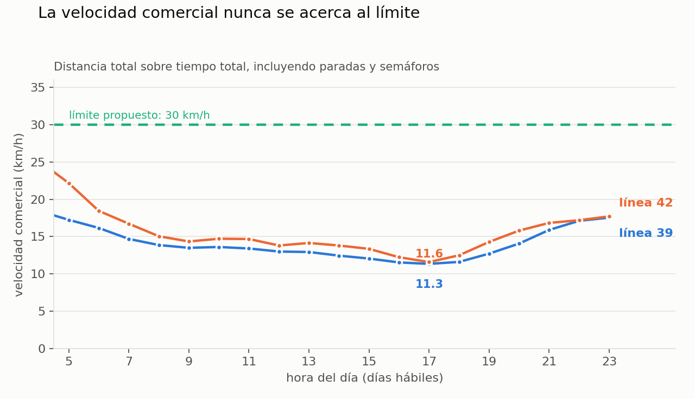
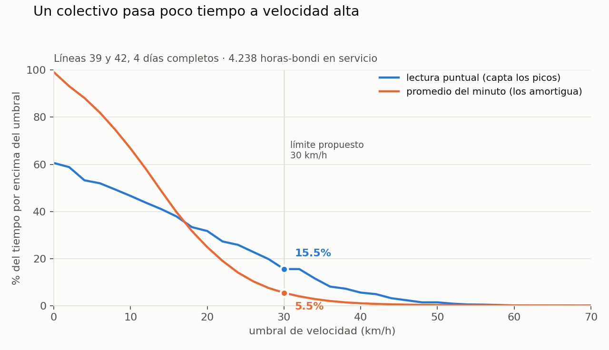
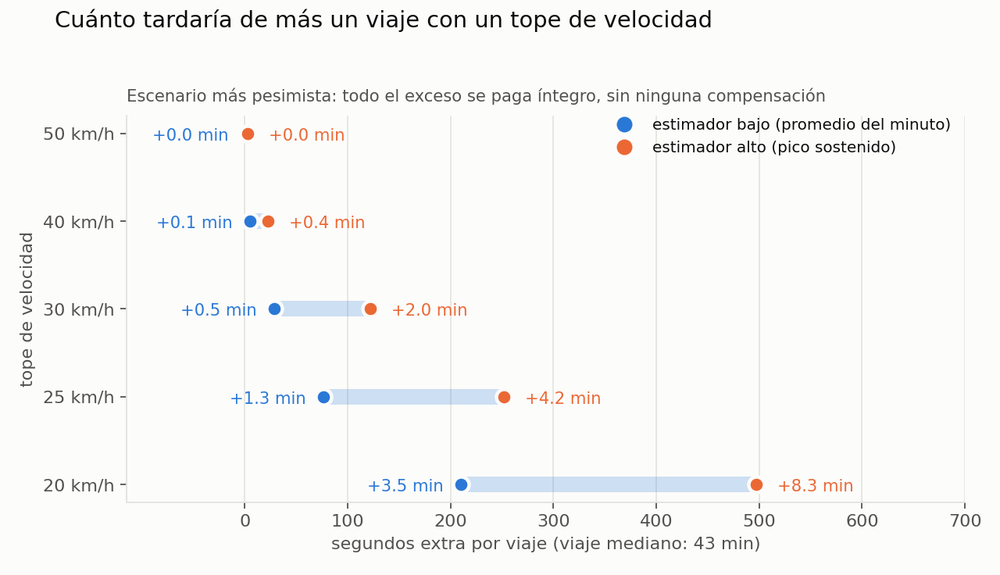

# Velocidad de colectivos vs. límite de velocidad — borrador

> **Corte grande:** [RESULTADOS_CABA_202607.md](RESULTADOS_CABA_202607.md) — las
> 27 líneas íntegramente porteñas, julio 2026 completo, medido sin usar
> recorridos. Este documento es el diseño metodológico y el caso chico que lo
> valida.

Caso de ejemplo: **líneas 39 y 42, 4 días completos** (mar 21, mié 22, jue 23 y
sáb 18 de julio de 2026). 146 vehículos, 7.384 viajes, 4.238 horas-bondi en
servicio, 60.240 km. Ambas líneas son íntegramente CABA, así que el resultado
habla directo de la discusión porteña.

Reproducir:

```bash
python -m experiments.velocidades.extract_tracks --lines 39 42 \
    --days 2026-07-21 2026-07-22 2026-07-23 2026-07-18 \
    --out experiments/velocidades/out/tracks.parquet
python -m experiments.velocidades.build_intervals \
    --tracks experiments/velocidades/out/tracks.parquet \
    --out    experiments/velocidades/out/intervals.parquet
python -m experiments.velocidades.metrics \
    --intervals experiments/velocidades/out/intervals.parquet \
    --outdir    experiments/velocidades/out
python -m experiments.velocidades.charts --outdir experiments/velocidades/out
```

Corre en **~75 s** para 4 días × 2 líneas (single core). Ver
[§5 Costo computacional](#5-costo-computacional) para el escalado medido.

---

## 1. Cómo está armado

### El dato

El grabador guarda, cada ~60 s, la posición de toda la flota del AMBA. Por
vehículo tenemos `lat/lon`, `speed` (lectura puntual, resolución 1 km/h),
`odo`, `trip_id` y `route_id`. La línea sale del sufijo del `label` vía
`LABEL_LINE_MAP.json`, resuelto por fecha.

### La unidad de análisis: el intervalo

Todo se calcula sobre **intervalos entre dos muestras consecutivas del mismo
viaje**, con `45 s ≤ Δt ≤ 90 s`. Fuera de esa ventana el intervalo tapa un hueco
de cobertura y la velocidad media deja de ser interpretable. Se descartan las
muestras sin `trip_id`: son movimientos a/desde garage y giradas de cabecera,
que inflan las velocidades con tramos sin pasajeros.

### Los dos instrumentos, y por qué hacen falta los dos

Hay **dos velocidades distintas** en el dato y confundirlas es el error clásico:

| | qué mide | para qué sirve | limitación |
|---|---|---|---|
| **lectura puntual** (`speed`) | velocidad instantánea en el momento del muestreo | **exposición**: qué fracción del tiempo el bondi va por encima de X | no dice cuánto duró ese instante |
| **promedio del intervalo** (distancia ÷ Δt) | velocidad media de ~60 s | **velocidad comercial**, tiempo de viaje | amortigua los picos: 60 km/h durante 10 s dentro de un minuto se ve como 20 km/h |

Como el muestreo es uniforme en el tiempo, la fracción de muestras por encima de
X estima sin sesgo la fracción de **tiempo** por encima de X. Por eso la lectura
puntual es el instrumento correcto para exposición, aunque no sirva para
distancia.

### Las tres formas de medir distancia (y la respuesta al "no tenemos los recorridos")

Esta era la parte que parecía bloqueante. No lo es. Medimos lo mismo por tres
caminos independientes y los comparamos sobre los mismos 238.375 intervalos:

| método | ¿necesita el recorrido? | km medidos | sesgo vs. shape | ratio p10–p90 |
|---|---|---|---|---|
| proyección sobre la polilínea | **sí** | 60.240 | — (referencia) | — |
| odómetro de la API, crudo | no | 58.880 | **−2,1 %** | 0,84 – 1,12 |
| odómetro, filtrando unidades rotas | no | 51.123 | **−0,2 %** | 0,90 – 1,10 |
| cuerda haversine punto a punto | no | 56.592 | **−6,1 %** | 0,77 – 1,00 |

**Conclusión operativa:** se puede hacer el análisis **sin recorridos**, para
cualquier línea del país. La cuerda haversine subestima ~6 % (es la diferencia
entre la cuerda y el arco: el bondi dobla, la línea recta no) y se corrige con
un factor único de 1,065. El odómetro es aún mejor, pero pide QC.

**Sobre el odómetro** — la sospecha de que es basura es medio cierta y medio no.
Por unidad, la mediana de `Δodo / Δshape` es **1,0025**: en las unidades sanas el
odómetro es prácticamente exacto, mejor que la geometría. Pero **13,5 % de las
unidades lo tienen roto**: pegado en 0 (hay coches que reportan 0 en el 82 % de
los minutos en que se movieron), o contando de a saltos. El filtro que uso es
por vehículo, no por muestra: ratio mediano dentro de [0,90 – 1,10] y menos de
5 % de deltas cero estando en movimiento. Con eso el sesgo agregado cae a
−0,2 %. Sin ese filtro, ~−2 %. **No lo usaría como fuente primaria** hasta
validarlo aparte contra más líneas — pero como tercer testigo que coincide con
la geometría dentro del 2 %, ya sirve para cerrar la discusión metodológica.

Los tres métodos dan la misma velocidad comercial dentro de ±0,7 km/h.

### La proyección sobre el recorrido (para el 39, que sí lo tenemos)

A cada viaje se le asigna el ramal+sentido que mejor lo explica: el que
minimiza el error perpendicular mediano sobre una muestra de 25 puntos del
viaje. No se usa `route_id` — rota cada pocas semanas y acá solo importa la
geometría. Después se proyectan todos los puntos sobre ese shape y la distancia
del intervalo es el delta de progresión. Se descartan los puntos a más de 120 m
del recorrido.

---

## 2. Qué dio

### Velocidad comercial

Distancia total ÷ tiempo total, incluyendo paradas y semáforos. Es el número que
siente el pasajero.

| línea | día | v. comercial | v. sin frenadas | muestras con el bondi frenado |
|---|---|---|---|---|
| 39 | hábil | **13,9 km/h** | 14,9 km/h | 39,7 % |
| 39 | sábado | 15,5 km/h | 16,4 km/h | 37,8 % |
| 42 | hábil | **15,0 km/h** | 17,4 km/h | 40,1 % |
| 42 | sábado | 17,2 km/h | 19,4 km/h | 37,6 % |

En la hora pico de la tarde (17 h) bajan a **11,3 km/h el 39** y **11,6 km/h el
42**. La 42 corre 16 % de su tiempo por Cantilo/Lugones, donde un límite urbano
no aplicaría; excluyendo ese tramo su velocidad comercial baja de 15,4 a
14,7 km/h — o sea, la autopista casi no la mueve.



Ojo con la columna "frenado": **no** es "% del tiempo detenido en paradas". En
los minutos donde la lectura puntual da 0, el vehículo igual promedió 12,3 km/h
en ese mismo minuto. O sea, es la probabilidad de encontrarlo frenado en un
instante cualquiera — un semáforo, no una parada larga.

### Exposición: cuánto tiempo por encima del umbral



Por encima de **30 km/h**: entre **5,5 % y 15,5 % del tiempo**, según el
instrumento. Por encima de 40: entre 1,0 % y 5,6 %. Por encima de 50: menos del
1,4 %. Por línea, con lectura puntual:

| umbral | 39 | 42 | 42 sin autopista |
|---|---|---|---|
| > 20 km/h | 30,9 % | 33,3 % | 31,8 % |
| > 30 km/h | 14,5 % | 17,8 % | 16,4 % |
| > 40 km/h | 4,7 % | 7,5 % | 6,3 % |
| > 50 km/h | 0,9 % | 2,6 % | 1,7 % |

### El contrafáctico: cuánto costaría un tope

Es la pregunta que importa. Para cada intervalo donde el bondi superó el tope,
se recalcula el tiempo como `distancia / tope`. **El escenario es el más
pesimista posible**: todo el exceso se paga íntegro, sin ninguna compensación —
ni menos congestión, ni mejor coordinación semafórica, ni cambio de demanda. Es
una cota superior del costo, no una predicción.

Dos estimadores que lo acotan:

- **bajo** — con el promedio del minuto. Si el bondi promedió 25 km/h en ese
  minuto, un tope de 30 no le hace nada, aunque haya tocado 45 durante 10 s.
  Subestima.
- **alto** — con la lectura puntual, suponiendo que esa velocidad se sostuvo el
  minuto entero. Sobreestima por construcción.



Sobre 5.226 viajes completos (mediana: 43 min, 10,3 km, 14,5 km/h):

| tope | tiempo extra por viaje | sobre el total del viaje | viajes sin ningún efecto (est. bajo) |
|---|---|---|---|
| 50 km/h | +1 s a +3 s | 0,06 % – 0,12 % | 92,5 % |
| 40 km/h | +5 s a +23 s | 0,21 % – 0,90 % | 76,9 % |
| **30 km/h** | **+28 s a +2 min** | **1,2 % – 4,8 %** | 24,9 % |
| 25 km/h | +1,3 min a +4,2 min | 3,1 % – 9,8 % | 5,0 % |
| 20 km/h | +3,5 min a +8,3 min | 8,3 % – 19,3 % | 0,1 % |

---

## 3. Qué se puede decir con esto, y qué no

**Se puede decir:**

- Un colectivo en CABA promedia **14 km/h**, menos de la mitad del tope de 30 que
  se discute. En hora pico, 11.
- El costo de un tope de 30 km/h para el pasajero, **en el escenario más
  pesimista imaginable**, está entre medio minuto y dos minutos sobre un viaje
  de 43 minutos. Cualquier efecto de segundo orden (menos congestión, olas
  verdes a 30) se come ese margen.
- Un tope de **40 km/h es gratis**: entre 5 y 23 segundos por viaje.

**No se puede decir** (y conviene no decirlo, porque es donde te van a pegar):

- *"Los bondis nunca van a más de 30."* Falso: pasan entre 5 % y 15 % del tiempo
  por encima, y el 75 % de los viajes tocaría el tope al menos una vez. El
  argumento fuerte no es la frecuencia, es la **magnitud del costo**.
- *"Esto prueba que un tope no cuesta nada."* El contrafáctico es una cota
  superior sobre el efecto mecánico directo. No modela evaporación de tránsito
  ni recoordinación semafórica — que es justamente el mecanismo por el cual, en
  la literatura, la velocidad real termina **subiendo**. Este dato acota el
  costo; el beneficio hay que traerlo de otro lado.
- Nada sobre el resto del AMBA todavía: dos líneas, cuatro días.

---

## 4. Cómo lo escalaría

1. **Más días** — 4 meses en vez de 4, para tener estacionalidad y días atípicos
   (lluvia, paros). El pipeline ya escala lineal.
2. **Más líneas sin recorrido** — con haversine corregido por 1,065, o con el
   odómetro filtrado. Se puede correr sobre las ~200 líneas del AMBA.
3. **Desagregación espacial** — cortar por tramo de recorrido en vez de por
   línea. Ahí aparece lo interesante: qué corredores concretos tienen exceso de
   velocidad y cuáles están saturados. Necesita recorrido, así que arranca por
   las 7 líneas que ya tenemos.
4. **Muestreo más fino** — el límite duro de todo esto es el ciclo de 60 s. Para
   estimar bien la exposición a velocidad alta habría que grabar un subconjunto
   de líneas cada 10 s. Es una decisión de grabador, no de análisis.

---

## 5. Costo computacional

Medido sobre `2026-07-21` (214 MB comprimidos, 1.244 MB crudos, 2.875 frames,
9,8 M registros `upd`), en un Ryzen 7 5800X3D / 32 GB, leyendo de `Z:` por SMB.

**Constantes medidas, un solo core:**

| etapa | costo | ¿escala con nº de líneas? |
|---|---|---|
| leer + descomprimir + parsear JSON | **7,4 s/día** | no — es el piso fijo |
| extracción (filtrado + armado de filas) | +1 s a +17 s/día | sí, suave |
| `build_intervals` sin proyección | **19,3 µs/fila** | sí, lineal |
| `build_intervals` con proyección sobre shapes | **103 µs/punto** | sí, y ×nº de ramales candidatos |
| `metrics` | **4,5 µs/intervalo** | sí, lineal |

Lectura cruda de SMB: 115 MB/s → los 4 meses son ~22 GB, o **3 min de piso de
I/O**. No es el cuello de botella; esto es CPU-bound y los días son
independientes, así que paraleliza casi perfecto.

**Extracción medida, mismo día, variando líneas:**

| líneas | filas/día | extracción |
|---|---|---|
| 2 | 94.665 | 8,4 s |
| 10 | 631.798 | 9,3 s |
| 40 | 1.946.658 | 11,7 s |
| 100 | 4.453.071 | 15,9 s |
| 254 (todo el AMBA) | 8.761.153 | 24,1 s |

**Proyección a 4 meses (120 días), pipeline completo sin proyección
geométrica:**

| líneas | por día | 120 días, 1 core | 120 días, 8 procesos |
|---|---|---|---|
| 2 | 10,5 s | 21 min | ~3 min |
| 10 | 23,5 s | 47 min | ~6 min |
| 40 | 55 s | 1 h 51 | ~14 min |
| **100** | **116 s** | **3 h 52** | **~29 min** |
| 254 | 221 s | 7 h 22 | ~55 min |

El término dominante a partir de ~40 líneas no es leer el NDJSON sino
`build_intervals` (74 % del total a 100 líneas). Es pandas sobre un DataFrame
grande; hay margen de optimización ahí si molesta.

**Lo caro es la proyección geométrica, no el volumen.** A 103 µs/punto contra
~9 ramales candidatos, proyectar 100 líneas × 120 días serían ~15 h de un core.
Por eso el método sin recorrido (haversine + factor 1,065) no es solo un
workaround por falta de shapes: es además dos órdenes de magnitud más barato.
La proyección conviene reservarla para las 7 líneas con shape, como control.

**Restricciones prácticas:**

- **Memoria, no tiempo, es el límite.** A 100 líneas son 4,45 M filas/día, ~3 GB
  de pico por worker con las copias intermedias de `build_intervals`. Con 32 GB
  no conviene pasar de **6-8 procesos**. Los 4 meses enteros (534 M filas) no
  entran en RAM: hay que procesar **día por día** y consolidar agregados. Se
  puede porque ningún viaje cruza la medianoche.
- **Disco, si persistís los intermedios**: `tracks` 12,4 B/fila y `intervals`
  38,3 B/fila en parquet → 100 líneas × 4 meses son **6,6 GB + 14 GB**. Si solo
  guardás los agregados por día, es despreciable. Recomiendo eso.
- Los números de arriba usan un día de 214 MB. Los archivos van de 50 a 310 MB
  según el día, así que tomá ±25 %.

## Archivos

| archivo | qué hace |
|---|---|
| `extract_tracks.py` | NDJSON.gz → parquet de posiciones crudas, filtrado por línea y fecha |
| `build_intervals.py` | posiciones → intervalos con las tres distancias y la asignación de ramal |
| `metrics.py` | intervalos → `metrics.json` + CSVs (excedencia, contrafáctico, por hora, viajes, QC odómetro) |
| `charts.py` | los tres gráficos |
